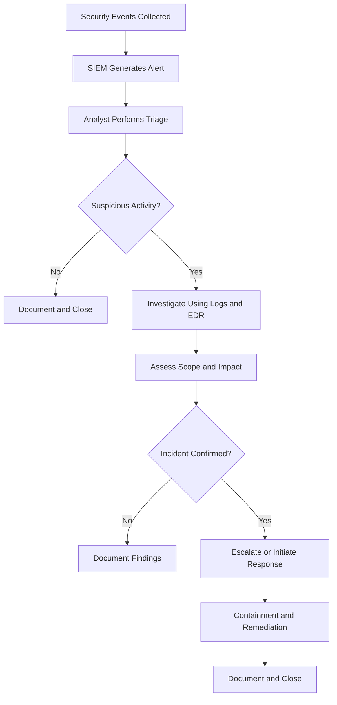

# SOC Fundamentals

This section documents the foundational concepts, technologies, workflows, and responsibilities involved in Security Operations Center (SOC) operations.

The notes are based on my learning through **LetsDefend SOC Fundamentals**, with concepts organized for revision, practical application, and cybersecurity interview preparation.

## Learning Objectives

- Understand the purpose, structure, and operation of a SOC.
- Learn the responsibilities of SOC analysts and their role in security investigations.
- Understand how SIEM, log management, EDR, SOAR, and threat intelligence support security operations.
- Identify common mistakes during alert triage and investigation.
- Build a foundation for SOC alert investigation and incident response.

## Topics Covered

| # | Topic | Status |
|---|---|---|
| 1 | [Introduction to SOC](introduction-to-SOC.md) | Completed |
| 2 | [SOC Types and Roles](soc-types-and-roles.md) | In progress |
| 3 | [SOC Analyst and Their Responsibilities](soc-analyst-responsibilities.md) | Planned |
| 4 | [SIEM and Analyst Relationship](siem-and-analyst-relationship.md) | Planned |
| 5 | [Log Management](log-management.md) | Planned |
| 6 | [EDR — Endpoint Detection and Response](edr.md) | Planned |
| 7 | [SOAR — Security Orchestration, Automation and Response](soar.md) | Planned |
| 8 | [Threat Intelligence Feed](threat-intelligence-feed.md) | Planned |
| 9 | [Common Mistakes Made by SOC Analysts](common-soc-analyst-mistakes.md) | Planned |

## Core SOC Technologies

| Technology | Purpose |
|---|---|
| SIEM | Correlates and analyzes security events to identify suspicious activity and generate alerts. |
| Log Management | Collects, stores, organizes, and provides access to log data for monitoring and investigation. |
| EDR | Monitors endpoint activity and supports endpoint threat detection, investigation, and response. |
| SOAR | Coordinates security workflows and automates repeatable response tasks. |
| Threat Intelligence | Provides information about threats, indicators of compromise (IOCs), adversary behavior, and attack infrastructure. |

These technologies serve different purposes and can work together during a security investigation.

## SOC Investigation Workflow

A typical SOC investigation follows a process like this:

*Note: Actual workflows vary by organization, security tooling, and incident severity.*

## Key Concepts to Remember

- An alert is not automatically a confirmed security incident.
- Analysts must validate alerts using evidence and context.
- Logs provide visibility into activity across systems, applications, and networks.
- SIEM, EDR, SOAR, and threat intelligence have complementary roles.
- Accurate documentation and appropriate escalation are essential parts of SOC work.

## Learning Progress

- [x] Introduction to SOC
- [ ] SOC Types and Roles
- [ ] SOC Analyst and Their Responsibilities
- [ ] SIEM and Analyst Relationship
- [ ] Log Management
- [ ] EDR
- [ ] SOAR
- [ ] Threat Intelligence Feed
- [ ] Common Mistakes Made by SOC Analysts

## Learning Resources

- [LetsDefend](https://letsdefend.io/) — SOC Fundamentals learning path

---

*These notes are maintained as part of my ongoing cybersecurity learning and SOC analyst portfolio.*
