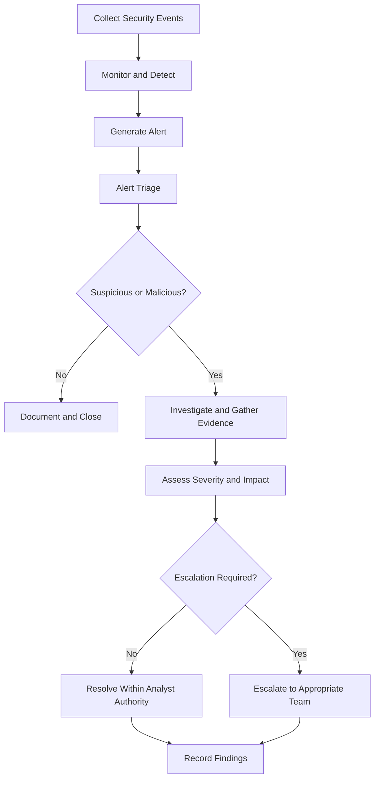
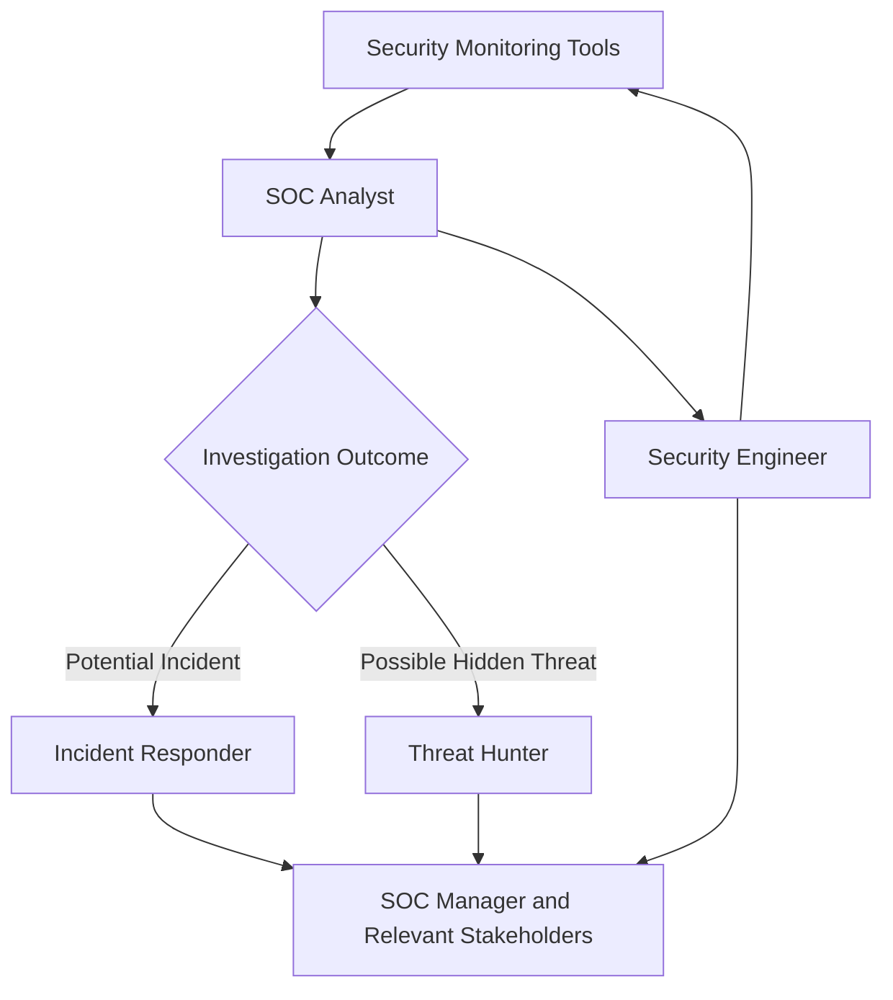

# SOC Types and Roles

## 1. What Is a Security Operations Center?

A **Security Operations Center (SOC)** is a centralized function responsible for monitoring an organization's systems, detecting suspicious activity, investigating security alerts, and coordinating responses to security incidents.

A SOC combines three essential elements:

- **People:** Analysts, incident responders, threat hunters, engineers, and managers.
- **Processes:** Alert triage, investigation, escalation, incident response, and documentation.
- **Technology:** SIEM, EDR, log management platforms, threat intelligence, and automation tools.

The primary objective of a SOC is to identify and respond to potential threats before they cause significant damage.

## 2. Types of SOC

Organizations can structure their SOC operations in different ways depending on their size, budget, security requirements, and available expertise.

| SOC Model | Description | Advantages | Considerations |
|---|---|---|---|
| In-house SOC | The organization operates its own SOC using internal employees and infrastructure. | Greater control over security operations and internal data. | Requires investment in staff, tools, and continuous coverage. |
| Virtual SOC | Security monitoring and operations are delivered remotely, often by a distributed team. | Flexible staffing and potentially lower infrastructure costs. | Requires reliable remote access, communication, and coordination. |
| Co-managed SOC | Internal security staff work alongside an external provider. | Combines internal business knowledge with external expertise. | Responsibilities and escalation procedures must be clearly defined. |
| Command SOC | A central team coordinates or oversees security operations across multiple teams, sites, or business units. | Supports consistent procedures, coordination, and organization-wide visibility. | Requires effective communication and clear decision-making authority. |

**Important:** These models describe different ways of organizing SOC operations. Actual responsibilities and service arrangements vary by organization.

### In-house SOC

An in-house SOC is operated directly by the organization. Its analysts monitor internal systems and investigate alerts using the organization's security tools and procedures.

**Example:** A bank maintains its own SOC to monitor employee endpoints, authentication events, network activity, and systems supporting financial services.

### Virtual SOC

A virtual SOC operates remotely rather than relying on a single physical SOC location. Analysts may work from different locations while accessing centralized security platforms.

**Example:** A company uses a distributed team to monitor alerts and investigate suspicious activity across its cloud environment.

### Co-managed SOC

A co-managed SOC combines internal security personnel with an external security provider. The two teams share responsibilities according to an agreed service model.

**Example:** An internal IT security team investigates business-specific incidents while an external provider supplies 24/7 monitoring and escalates high-priority alerts.

### Command SOC

A command SOC provides centralized oversight or coordination across multiple security operations teams or locations. It may help standardize procedures, coordinate major incidents, and provide a consolidated view of security activity.

**Example:** A multinational company coordinates security operations across regional SOC teams through a central function.

## 3. How a SOC Operates

A SOC typically follows a repeatable workflow to process security events and investigate potential threats.

The exact workflow varies by organization. Some steps may be automated, and confirmed incidents may require a dedicated incident response process.

## 4. SOC Analyst Levels

Some SOCs divide analyst responsibilities into Level 1, Level 2, and Level 3. These levels are common, but they are not universal; job titles and authority differ between organizations.

| Level | Typical Responsibilities |
|---|---|
| L1 — Alert Triage | Reviews incoming alerts, validates initial evidence, prioritizes alerts, gathers context, and escalates suspicious cases. |
| L2 — Investigation | Performs deeper investigations, correlates evidence across multiple sources, determines scope, and supports incident containment. |
| L3 — Advanced Analysis | Handles complex investigations, advanced threat analysis, detection engineering, and difficult escalations. May support threat hunting and incident response. |

### Example: Suspicious Login

- **L1:** Reviews an alert for repeated failed logins followed by a successful login.
- **L2:** Checks authentication logs, source IP reputation, user activity, and endpoint telemetry to determine whether the account may be compromised.
- **L3:** Helps investigate a complex or widespread compromise, develops improved detections, or supports advanced analysis when required.

Not every SOC uses this exact division. In smaller teams, one analyst may perform tasks across multiple levels.

## 5. Key SOC Roles

| Role | Main Responsibilities |
|---|---|
| SOC Analyst | Monitors alerts, performs triage, investigates suspicious activity, documents findings, and escalates cases. |
| Incident Responder | Coordinates the handling of confirmed incidents, including containment, eradication, recovery, and lessons learned. |
| Threat Hunter | Proactively searches for threats that may not have triggered existing security alerts. |
| Security Engineer | Deploys, maintains, integrates, and improves security technologies and detection capabilities. |
| SOC Manager | Oversees SOC operations, staffing, procedures, performance, reporting, and operational priorities. |

### SOC Analyst

The SOC analyst is often the first person to examine a security alert. The analyst must distinguish benign activity from suspicious behavior, collect relevant evidence, and decide whether further investigation or escalation is necessary.

Typical tasks include:

- Monitoring and reviewing SIEM alerts.
- Examining logs and endpoint telemetry.
- Checking indicators of compromise (IOCs).
- Assessing alert severity and potential impact.
- Recording evidence and investigation steps.
- Escalating cases according to established procedures.

### Incident Responder

Incident responders focus on managing confirmed or suspected security incidents. Depending on the organization, they may coordinate containment, remove malicious artifacts, support system recovery, and document lessons learned.

### Threat Hunter

Threat hunters proactively investigate environments for signs of compromise that existing alerts or automated detections may have missed.

For example, a threat hunter may search endpoint telemetry for unusual PowerShell execution or suspicious authentication patterns across multiple systems.

### Security Engineer

Security engineers build and maintain the technical capabilities used by security teams. Their work may include SIEM integrations, endpoint security deployments, detection rules, logging pipelines, and automation.

### SOC Manager

The SOC manager ensures that the team operates effectively. Responsibilities may include staffing and shift coverage, incident escalation policies, reporting, training, and coordination with other departments.

## 6. How the Roles Work Together

The SOC analyst, incident responder, threat hunter, security engineer, and SOC manager have different primary responsibilities, but their work overlaps. Effective security operations depend on sharing evidence, following procedures, and communicating clearly.

## 7. Key Terms

| Term | Meaning |
|---|---|
| Security Event | An observable activity recorded by a system or security tool. |
| Alert | A notification generated when activity matches a rule, threshold, or detection condition. |
| Security Incident | An event or series of events that requires a security response because confidentiality, integrity, or availability may be affected. |
| Alert Triage | The initial review used to validate, prioritize, and route an alert. |
| Escalation | Transferring a case to a team or individual with the required expertise or authority. |
| IOC | Indicator of Compromise; evidence that may indicate malicious activity, such as a suspicious file hash or IP address. |
| Telemetry | Activity and technical data collected from systems, endpoints, networks, or applications. |
| Threat Hunting | Proactively searching for potentially malicious activity that existing detections may not have identified. |

## 8. Common Mistakes to Avoid

- Assuming every alert represents a confirmed incident.
- Closing alerts without sufficient evidence or documentation.
- Escalating cases without explaining the findings and reason for escalation.
- Ignoring business context, asset criticality, or user activity.
- Confusing threat hunting with routine alert monitoring.
- Assuming every SOC uses the same team structure or L1–L3 model.

A strong SOC analyst follows evidence, documents decisions, and escalates according to the organization's procedures.

## 9. Interview Questions and Answers

### Q1. What is a SOC?

A SOC is a security function that monitors systems, detects threats, investigates alerts, and coordinates responses to security incidents using people, processes, and technology.

### Q2. What is the difference between an in-house SOC and a co-managed SOC?

An in-house SOC is operated internally by the organization. A co-managed SOC combines internal security personnel with an external provider that shares agreed monitoring, investigation, or response responsibilities.

### Q3. What does an L1 SOC analyst do?

An L1 analyst performs initial alert triage, reviews available evidence, prioritizes alerts, documents findings, and escalates suspicious cases when deeper investigation is required.

### Q4. How does a threat hunter differ from a SOC analyst?

A SOC analyst commonly investigates alerts generated by existing detections. A threat hunter proactively searches for suspicious activity that may have gone undetected.

### Q5. When should an analyst escalate an alert?

An analyst should escalate when the evidence, potential impact, severity, uncertainty, or required response exceeds their authority or the organization's defined escalation criteria.

### Q6. Why are people, processes, and technology all important in a SOC?

Technology provides visibility and detection capabilities, people interpret evidence and make decisions, and processes help ensure that investigations and responses are consistent, documented, and appropriately escalated.

## 10. Key Takeaways

- SOC models differ according to how security operations are organized and delivered.
- People, processes, and technology work together to support security monitoring and incident response.
- SOC analysts validate alerts and gather evidence before deciding on the next action.
- Incident responders manage security incidents, threat hunters search proactively, and security engineers improve security capabilities.
- SOC role boundaries vary by organization, and effective collaboration is essential.

## Learning Source

- LetsDefend — SOC Fundamentals: SOC Types and Roles

*These notes are written for learning, revision, practical application, and SOC analyst interview preparation.*
